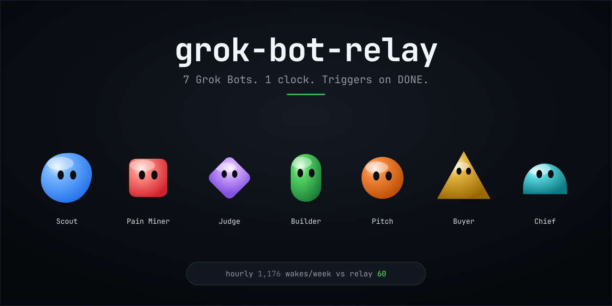
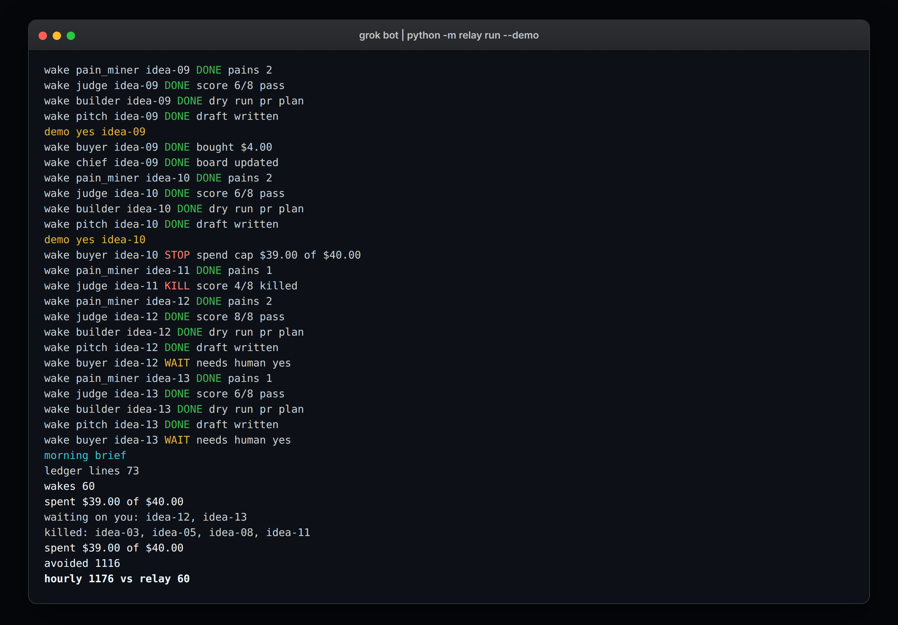
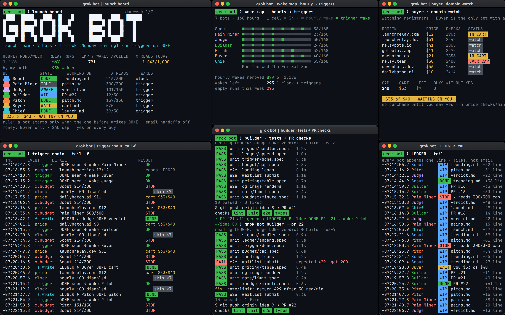
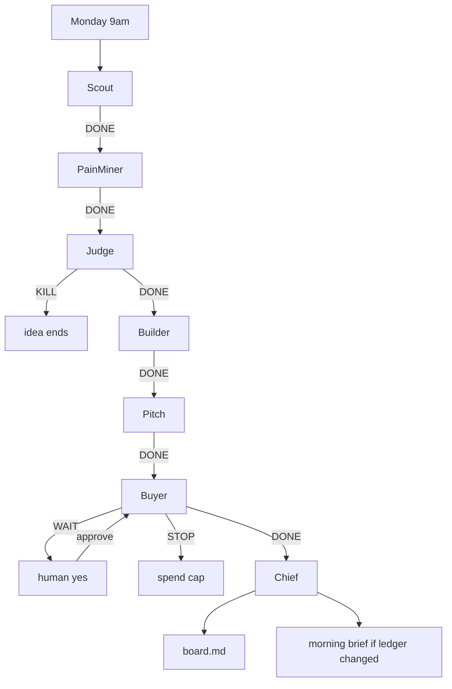

# grok-bot-relay



7 Grok Bots. 1 clock. Triggers on DONE.

## Why

Bots on hourly timers wake 1,176 times a week. This relay keeps one clock. Scout runs Monday morning. Every other bot starts when the previous bot writes DONE. A week of work is about 60 wakes.

X reads stay inside 1,000 a day and 30 a minute, split across the bots. At the cap a bot writes STOP.

Buyer is the only bot that spends. The cap is $40, and every buy needs a yes.



## Bots

| Bot | Starts | What it does | Daily X reads | Per minute |
| --- | --- | --- | --- | --- |
| Scout | Monday 9am | Finds the week's ideas from seeded search | 300 | 9 |
| Pain Miner | Scout DONE | Writes the pain note for one idea | 300 | 8 |
| Judge | Pain Miner DONE | Scores 4 checks from 0 to 2, kills a total under 5 of 8 | 150 | 4 |
| Builder | Judge DONE | Writes a branch and PR plan. Dry run. Merge stays off | 50 | 2 |
| Pitch | Builder DONE | Writes a launch post draft under drafts/ | 150 | 5 |
| Buyer | Pitch DONE | Spends only after a human yes, cap $40 | 0 | 0 |
| Chief | Buyer DONE | Updates board.md, and prints a morning brief only when the ledger changed | 50 | 2 |

## Quick start

Clone the repo, init a workspace, then run a fixed week or open the wall.



The terminal wall is an illustrative simulation with demo values.

```bash
git clone https://github.com/Gipppp121/grok-bot-relay.git
cd grok-bot-relay
python -m relay init
python -m relay run --demo
python -m relay wall
```

`run --demo` uses a fixed Monday (26 Oct 2026, 09:00 UTC) so the wake count does not depend on the day you run it. The live scheduler (`tick` and `run`) uses local time: Scout becomes due on Monday at 09:00 and runs once that week.

The demo records a scripted yes for the buys that fit, through the same approvals file as `python -m relay approve <id>`. Two ideas are left waiting. Buyer still refuses a buy that has no yes.

```text
hourly 1176 vs relay 60
```

`python -m relay wall` serves `web/index.html` at http://127.0.0.1:8000/ until you stop it. Press f in the page for fullscreen. The same file is copied to `docs/index.html` for GitHub Pages.

## Architecture



Handoffs are lines in `ledger.jsonl`: `ts`, `bot`, `idea_id`, `status` (`WIP`, `DONE`, `STOP`, `WAIT`, `KILL`), `note`. The file is append only. One process can append from several threads. A second process waits on an advisory lock.

`tick` polls the ledger and runs at most one ready bot. `run --demo` walks a whole week. Each demo wake is one simulated minute apart, so the 30 reads a minute cap stays in force.

Read slices live in `relay.toml` (a `relay.json` file works too). A bot that would pass its slice writes `STOP` and sleeps until that minute or that day resets.

Buyer reads `approvals.json`. `python -m relay approve idea-01` records the yes. There is no path that buys on its own. Builder writes `plans/<id>.md` and does not merge. Pitch writes `drafts/<id>.md` and does not post.

Chief republishes the launch board:

| idea | stage | owner bot | waiting on me | last update |
| --- | --- | --- | --- | --- |

The morning brief is printed only when the ledger has grown since the last brief.

X search and GitHub are optional adapters in `relay/adapters/x_search.py` and `relay/adapters/github.py`. They fail closed. The demo uses seeded data and never opens a socket. `merge` stays disabled.

Bots are classes with `run(idea, ctx)`. Swap one by passing a new map into the engine.

## Use it with Grok Bot

```text
You are Launch Relay, chief of 7 bots: Scout, Pain Miner, Judge, Builder, Pitch, Buyer, Chief.

1. Only Scout runs on a clock, Monday morning. Every other bot starts when the one before it writes DONE.
2. All handoffs go in the LEDGER file, never email.
3. Split my 1,000 X reads a day between the bots. At the cap a bot writes STOP.
4. Buyer is the only bot that spends: $40 cap, my yes on every buy.
5. Nothing gets posted, bought or merged without my yes.

Start by asking me what Scout should look for and which repo Builder uses. Keep a Launch Board and message me only when the LEDGER changes.
```

## Commands

```bash
python -m relay init
python -m relay tick
python -m relay run --demo
python -m relay board
python -m relay ledger tail -f
python -m relay approve idea-01
python -m relay stats
python -m relay wall
```

Python 3.10 or newer. The standard library is enough. No pip install.

## Tests

```bash
python -m unittest discover -s tests -v
```

GitHub Actions runs that on Python 3.11 and 3.12.

## License

MIT. Copyright 2026 gipp.
